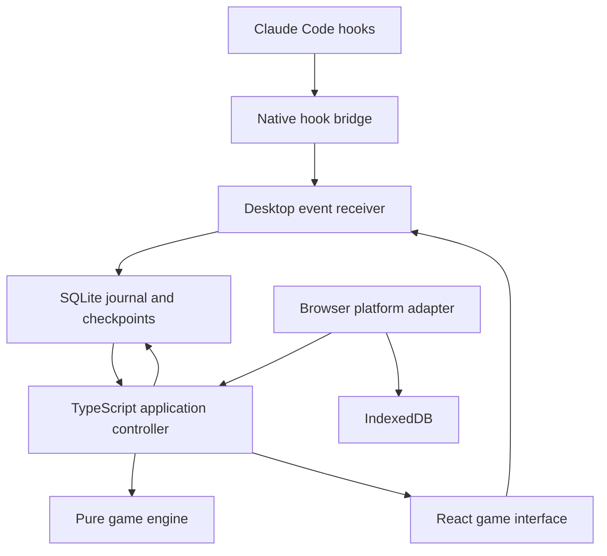

# Clawdle Architecture

Clawdle is a free, open-source word game where a player tries to solve a five-letter word before a local coding agent finishes its current turn. It also works as a standalone daily puzzle and unlimited practice game.

This document is the implementation blueprint. The repository starts with this document; components, commands, schemas, and performance targets below describe the intended implementation, not features that already exist.

## 1. Product boundaries

The primary experience is a compact desktop game that appears while Claude Code is working. The word grid takes priority; agent information is limited to a status indicator, race timer, and result. Clawdle must be enjoyable without an agent connection.

### Required constraints

- Application code is MIT licensed. Third-party dictionaries retain their own required notices.
- No account, API key, paid API, hosted database, subscription, advertisements, telemetry, or external model request.
- All puzzle generation, validation, gameplay, statistics, and agent integration run locally.
- Installed desktop gameplay works without an internet connection.
- Clawdle observes agent lifecycle metadata. It never operates the agent, grants permissions, edits a project, or verifies generated code.
- Hook failures must leave the coding session unaffected. Hooks run asynchronously, produce no decision output, and exit quickly.
- Automatic presentation never takes keyboard focus from the IDE or terminal.
- Closing a window preserves the puzzle. A race outcome never changes a daily streak.

The user's independently installed coding agent may have its own subscription or usage costs. Clawdle does not invoke its model, purchase access, or create additional AI usage. Standalone modes need no agent installation.

### Release scope

| Capability | First release | Later |
| --- | --- | --- |
| Five-letter puzzles, six guesses, duplicate-letter scoring | Required | Additional word lengths only through a separate rules version |
| Daily Clawdle and Endless | Required | Optional local archives |
| Beat Claude with supported local Claude Code hooks | Required | Additional verified provider adapters |
| Windows desktop installer and offline use | Required | Linux and macOS packaging |
| Local statistics, resume, export, emoji sharing | Required | Import improvements and themes |
| Speedrun | Designed here; follows the MVP | Additional durations |
| Browser standalone build | Shares the same implementation | Installable offline PWA |
| Public leaderboards and multiplayer | Excluded | Would require a separate product and cost decision |

## 2. Technology decisions

| Layer | Choice | Purpose |
| --- | --- | --- |
| Workspace | pnpm workspace plus a Rust Cargo workspace | Small monorepo without a separate task-orchestration service |
| Game and application logic | TypeScript in strict mode | Reusable deterministic rules and controllers |
| Interface | React and Vite | One interface for desktop and browser builds |
| Presentation state | Zustand | Draft letters, dialogs, selected mode, and derived views |
| Styling | CSS variables and component CSS | Precise visual control with no runtime styling service |
| Desktop container | Tauri 2 | Native window, tray, notifications, and packaging |
| Native bridge | Bundled Rust executable | Hook handling without requiring Node.js or Python on the player's computer |
| Local receiver | Rust, Tokio, and Axum inside the desktop process | Authenticated loopback event intake |
| Desktop persistence | SQLite through a narrow Rust repository API | Atomic saves, migrations, and durable event ordering |
| Browser persistence | IndexedDB behind the same repository interface | Standalone daily and practice saves |
| Validation | JSON Schema contracts, generated TypeScript types, Rust validation | One versioned boundary contract for both runtimes |
| Tests | Vitest, React Testing Library, Playwright, and Cargo tests | Rules, interface, transport, and native persistence |

Use the stable Tauri 2 release line and compatible dependencies, with exact versions captured in `pnpm-lock.yaml` and `Cargo.lock`. Pin the supported toolchain in the repository when implementation begins. No desktop user should need a development toolchain.

The bridge is native rather than a Node.js CLI so installation remains self-contained and hook processes start quickly. The pure game engine remains TypeScript; Rust does not implement a second copy of letter scoring or mode rules.

## 3. System structure and ownership



The native receiver assigns a durable sequence number and monotonic receipt timestamp to incoming agent events and player commands. The application controller consumes that ordered stream and applies pure reducers. React renders the resulting state; component animation completion is never a game or race event.

This small journal solves a specific desktop problem: hidden or throttled webviews must not miss a completion event and award a player a later win. It is a local SQLite table, not a distributed event system. It contains sanitized metadata and game actions only.

### Responsibilities

| Component | Owns | Must not own |
| --- | --- | --- |
| `game` | Scoring, validation, puzzle state, word selection, mode reducers, race reducer | React, files, networking, Tauri, provider-specific hook parsing |
| `app-core` | Ordered dispatch, recovery, save transactions, statistics, effects | UI styling or direct platform API calls |
| `ui` | Grid, keyboard, status, results, settings, accessibility | Independent winner decisions or statistics counters |
| `platform-desktop` | Typed Tauri calls, journal consumption, native effects | Raw hook payload handling |
| `platform-web` | IndexedDB, browser clock, clipboard, single-tab ownership | Automatic local-agent discovery or loopback requests |
| `agent-adapters/claude` | Allowlisted Claude metadata extraction and event normalization | Reading transcripts, prompts, source files, or responses |
| `local-bridge` | Stdin handling, short local delivery, optional cold launch | Game state, long-running polling, or model access |
| Native desktop service | Listener, sequencing, SQLite transactions, OS lifecycle | A duplicate implementation of puzzle rules |

There is one authoritative controller for a running desktop installation. A browser tab runs its own standalone controller. Browser and desktop statistics are separate unless the user exports and imports them; there is no hidden synchronization.

## 4. Repository layout

Use the following paths as the intended layout. Create packages only as their implementation becomes necessary.

| Path | Contents |
| --- | --- |
| `apps/web/` | Vite browser entry point using shared UI and the web platform adapter |
| `apps/desktop/` | Vite desktop entry point using shared UI and the desktop adapter |
| `apps/desktop/src-tauri/` | Tauri application, loopback receiver, SQLite repository, tray, window lifecycle, capabilities |
| `packages/game/src/scoring/` | Duplicate-letter scorer and keyboard-state merger |
| `packages/game/src/dictionary/` | Dictionary loading, validation, immutable word IDs |
| `packages/game/src/modes/` | Daily, endless, and speedrun reducers |
| `packages/game/src/race/` | Race reducer, eligibility rules, outcomes, clock helpers |
| `packages/app-core/` | Application commands, journal projector, persistence ports, statistics, recovery |
| `packages/ui/` | Shared React components, CSS tokens, input handling, view selectors |
| `packages/platform-desktop/` | Typed native invoke and event adapters |
| `packages/platform-web/` | IndexedDB repository and browser implementations of platform ports |
| `packages/contracts/` | Wire JSON schemas, generated types, provider-neutral events, test vectors |
| `crates/local-bridge/` | Installed `clawdle-bridge` hook and diagnostic binary |
| `crates/agent-adapters/` | Native provider parsers and metadata allowlists; Claude implemented first |
| `crates/local-runtime/` | Shared receiver, mailbox, protocol validation, and endpoint discovery helpers |
| `assets/words/` | Vendored source, curated answers, accepted guesses, frozen daily schedule, manifest |
| `assets/licenses/` | Dictionary notices and dependency attribution |
| `assets/branding/` | Original icon, wordmark, and screenshots |
| `scripts/` | Dictionary generation, contract generation, build, release, and fixture scripts |
| `tests/fixtures/hooks/` | Synthetic sanitized provider payloads and malformed-input fixtures |
| `tests/e2e/` | Gameplay, simulated agent races, restart, and focus tests |
| `docs/` | Installation, troubleshooting, contribution, and privacy documentation |
| `ARCHITECTURE.md`, `README.md`, `LICENSE`, `THIRD_PARTY_NOTICES.md` | Architecture, user documentation, and licenses |

Dependency direction is `UI -> app-core -> game/contracts`; platform adapters implement app-core ports. Neither `game` nor `app-core` imports a desktop or browser implementation. Cargo crates follow the equivalent direction toward shared contracts and provider parsers.

## 5. Core game model

```ts
type Mode = 'daily' | 'endless' | 'race' | 'speedrun';
type TileState = 'absent' | 'present' | 'correct';
type PuzzleStatus = 'playing' | 'solved' | 'exhausted' | 'given_up';

interface Guess {
  word: string;                  // Canonical uppercase ASCII, exactly 5 letters
  tiles: readonly TileState[];    // Exactly 5 entries
  submittedSeq: number;
  elapsedMs: number | null;
}

interface Puzzle {
  gameId: string;
  mode: Mode;
  rulesVersion: 'wordle-5x6-v1';
  dictionaryVersion: string;
  wordId: string;                // Stable ID, never a mutable array offset
  guesses: readonly Guess[];
  status: PuzzleStatus;
  startedAtUtc: string;
  finishedAtUtc: string | null;
  elapsedMs: number | null;
  timingValid: boolean;
  dailyKey: string | null;       // YYYY-MM-DD in UTC
  speedrunId: string | null;
}
```

Rules:

1. A puzzle has exactly five letters and at most six accepted guesses.
2. A guess must match `^[A-Z]{5}$` and exist in the bundled accepted-guess set.
3. An invalid guess produces feedback without consuming a row or changing statistics.
4. A correct guess ends the puzzle immediately, including a correct sixth guess.
5. An incorrect sixth guess ends the puzzle as exhausted.
6. Terminal puzzle state cannot accept another guess; a continuing race puzzle remains playable only if its puzzle state is still `playing`.
7. Draft input and reveal animations do not affect rules, clocks, or persistence of accepted guesses.

Engine operations are pure functions such as `scoreGuess`, `validateGuess`, `submitGuess`, `selectDailyWord`, `selectEndlessWord`, `reduceRace`, and `deriveStats`. Dependencies such as time and randomness arrive as inputs, so tests do not rely on the real clock.

### Duplicate-letter scoring

Use two passes:

1. Mark exact-position matches as correct. Count only the remaining unmatched answer letters.
2. Visit unmatched guess positions from left to right. Mark a letter present only if its remaining count is positive, then decrement that count. Otherwise mark it absent.

For answer `APPLE` and guess `ALLEY`, the result is correct, present, absent, present, absent. The second `L` is absent because the answer has only one unmatched `L`.

Merge keyboard states by strength: `correct > present > absent > unknown`. A later gray occurrence of a letter must never erase an earlier green or yellow keyboard state.

### Input and presentation

The controller acknowledges a guess before its reveal animation finishes. Persist the resulting row and logical outcome first, then animate it. Repeated Enter presses share an action ID or are ignored while the same submission is pending. A held physical key must not create multiple guesses.

Physical input is scoped to the focused game surface; do not install a global keyboard hook. Ignore composition events and keystrokes aimed at settings fields. Mouse and physical keyboard dispatch the same commands. A mode switch cannot replace a live puzzle without preserving it or explicitly giving it up.

## 6. Dictionary and answer selection

Maintain two collections:

- `answers-v1.json`: curated common answers, excluding proper nouns, offensive answers, abbreviations, and unsuitable obscure words.
- `guesses-v1.txt`: a broader accepted-guess set. Every answer must also be an accepted guess.

Use the English Speller Database, formerly SCOWL, as the initial licensed source for accepted guesses. Vendor a pinned upstream revision and its complete `Copyright` notice. Generate an American-English list at a documented size no greater than 80, then filter to five ASCII letters and apply the project's exclusion and inclusion files. Do not ship the upstream database or scrape Wordle's answer schedule. Curate the answer collection independently from the generated candidates.

The reviewed upstream notice permits redistribution of generated word lists with attribution. Retain the complete notice anyway, and recheck it at the exact revision selected during implementation. The architecture does not substitute the app's MIT license for dictionary attribution.

`assets/words/manifest.json` records source URL, source revision, source checksum, generation options, notice checksum, dictionary version, schedule version, generated file checksums, and entry counts. Generation uses vendored data; normal application builds and gameplay never download words. Fetching an upstream update is a separate maintainer action.

Only generated word files, manifests, and notices enter runtime bundles. Upstream source/database files and any Python-based generation tools stay in the maintainer workflow and are excluded from packaged application assets.

A stable word ID is `en-v1:<lowercase-word>`. Store IDs and dictionary versions with games. Later releases keep the data needed to resume earlier puzzles, or perform an explicit migration that preserves the original answer.

### Daily mapping

Freeze a published ordered array of answer IDs in `daily-v1.json`. Freeze its checksum and reference date, `2026-10-12T00:00:00Z`.

```ts
const DAY_MS = 86_400_000;
const EPOCH_MS = Date.UTC(2026, 9, 12);

function dailyWordId(nowMs: number, schedule: readonly string[]): string {
  if (schedule.length === 0) throw new Error('Empty daily schedule');
  const date = new Date(nowMs);
  const midnight = Date.UTC(
    date.getUTCFullYear(), date.getUTCMonth(), date.getUTCDate()
  );
  const day = Math.floor((midnight - EPOCH_MS) / DAY_MS);
  const index = ((day % schedule.length) + schedule.length) % schedule.length;
  return schedule[index];
}
```

Daily identity is `(scheduleVersion, UTC date)`. All supported installations using the frozen schedule receive the same answer on the same UTC date. The public puzzle number begins at 1 on the reference date. Do not expose historical daily creation before the launch date in the normal interface.

The schedule repeats after its length in days. Freeze `daily-v1` permanently so software updates do not change today's word. If a replacement is needed, publish a dated schedule transition; append-and-recalculate with a new modulus is forbidden.

At midnight, keep the current game under its original date and offer today's puzzle separately. A persisted unfinished puzzle can be completed later under its original key; users cannot create arbitrary past-day official games. Device-clock manipulation cannot be prevented offline, and there is no public competitive claim that requires it.

### Endless and race selection

Use local cryptographic randomness through a platform port. Sample uniformly from answer IDs, excluding the last 50 selected answers when the collection is large enough. Fall back to the full answer collection if exclusion would empty it. Persist the chosen answer before presenting the puzzle.

Race answers are independent of daily answers. Opening a race never consumes a daily attempt.

## 7. Game modes

### Daily Clawdle

- One official game per `(daily-v1, UTC date)` in each local profile.
- Resume an unfinished game. A completed daily game cannot be restarted for another official result.
- Six guesses, no agent dependency, no race timer requirement.
- Statistics include completion, win percentage, guess distribution, and streaks by puzzle date.
- The same date and schedule produce the same puzzle across platforms; saves are local to each installation.

### Endless

- Unlimited independently selected games.
- Start immediately without setup.
- Track practice wins, guess distribution, and eligible solve times.
- A manual give-up reveals the word and records a loss. Closing the window merely saves it.

### Beat Claude

- Race one selected top-level agent turn against one separate puzzle.
- Show agent working/attention/completed status, elapsed race time, eligible personal best, and player-versus-agent record.
- A player solve before an observed completion wins; observed completion first loses.
- Six failed guesses lose even if the agent is still working.
- After the agent finishes first, preserve the remaining rows and offer Continue solving. That continuation cannot change the race outcome or ordinary daily/endless statistics.
- A player win freezes the race result while the agent status may continue updating.

A task can include multiple turns. Beat Claude measures the observed response boundary for its bound turn; it does not claim that the requested work passed tests or was fully completed. If another Stop hook makes the agent continue, Clawdle still keeps the first observed boundary as its race definition.

### Speedrun

Implement after the MVP behind a mode flag, using the same engine and persistence ports.

- Initial duration: 60 seconds, fixed at run creation.
- Solve as many independent words as possible before the deadline.
- Six guesses per puzzle. Exhaustion or an explicit skip moves to the next puzzle without increasing solved count.
- A solve counts only when its command receipt is strictly before the deadline. An exact deadline tie belongs to the clock.
- Create the next logical puzzle immediately; animation timing cannot extend the run.
- Keep speedrun statistics separate from daily, practice, and race records.
- Reload, process restart, or sleep invalidates a live timed run. Save it as interrupted rather than inventing a score.

## 8. Provider-neutral event contract

The bridge must normalize provider input before it crosses the local transport boundary.

```ts
type AgentEventType =
  | 'agent.started'
  | 'agent.activity'
  | 'agent.needs_attention'
  | 'agent.turn_completed'
  | 'agent.session_ended';

interface AgentEvent {
  protocolVersion: 1;
  eventId: string;                 // UUID; retained on a delivery retry
  provider: string;                // Registered adapter, initially 'claude'
  sessionId: string;               // Provider identifier, opaque locally
  turnId: string | null;           // Provider prompt_id when available
  scope: 'root' | 'child';
  type: AgentEventType;
  sourceEvent: string;             // Allowlisted lifecycle name
  observedAtUtc: string;           // Diagnostic; not the race ordering clock
  projectKey: string | null;       // Hash with an installation-specific salt
  attentionKind?: 'permission' | 'input';
  activityKind?: 'session_ready' | 'tool_started' | 'tool_finished' | 'system_turn';
  endReason?: 'closed' | 'interrupted' | 'provider_error' | 'unknown';
}
```

The native receiver wraps this as a journal entry with `seq`, `runtimeEpoch`, `receivedAtUtc`, and `receivedMonoMs`. Those trusted receipt fields are assigned locally, never accepted from the bridge. Player commands receive the same wrapper and ordering.

Protocol v1 validates enums, identifier lengths, UUIDs, timestamps, allowed fields, and maximum payload size. Reject incompatible protocol versions. An adapter can ignore unknown provider input fields while still sending a strictly validated normalized envelope.

### Identity and session isolation

The race binding is `(provider, sessionId, turnId)`, with a separate random `raceId`. A session alone is insufficient because it can contain many prompts.

Use documented `prompt_id` when present. Do not pretend that a provider supplies a universal `turn_id`. If trustworthy turn identity is absent, display session status but disable automatic ranked races for that session. A later adapter may provide a separately tested correlation mechanism; uncorrelated legacy events must never finish a different race.

Ignore child-scope events for root race starts and completion. They may contribute a working indicator only when their parent identity is known. Subagent completion is never root completion.

`SessionStart` establishes readiness, not an active turn. A late completion for a previously closed turn updates only its historical status. A session-end event applies to its session and cannot terminate another session's race.

## 9. Claude Code adapter

Hook behavior was checked against the official Claude Code documentation on October 12, 2026. During implementation, pin and smoke-test the minimum supported Claude Code version; do not guess a version number from this document.

| Claude hook | Clawdle interpretation |
| --- | --- |
| `SessionStart` | Readiness activity; never starts a race |
| `UserPromptSubmit` | Root turn start, bound to available `prompt_id`; a system-initiated result turn is `agent.activity` / `system_turn` and never starts a race |
| `PreToolUse` / `PostToolUse` | Optional working activity; no tool arguments retained |
| `PermissionRequest` | Permission attention, without a decision |
| `Notification` with permission/input subtype | Attention indicator |
| `Stop` | Observed turn boundary, never verified task success |
| `StopFailure`, when supported | Provider error, neutral interruption |
| `SessionEnd` | Session closed |
| `SubagentStop` | Never completes a root race |

Normalize `StopFailure` as `agent.turn_completed` with `endReason: 'provider_error'`; the race reducer handles that reason as neutral interrupted before applying ordinary completion logic. It does not mark the whole session closed. Normalize actual `SessionEnd` as `agent.session_ended`.

Command hooks receive stdin JSON. Allowlist `session_id`, `prompt_id`, event name, scope metadata, notification subtype, and coarse termination flags. Discard `prompt`, response text, tool input/output, notification message bodies, and transcript paths; never open the transcript.

Install asynchronous command hooks. The bridge writes no stdout/stderr context, emits no permission or Stop decision, and returns exit code 0 on malformed input or delivery failure. It enforces its own short deadline because async-hook timeout behavior must not be relied upon.

#### System-initiated turns

When the Agent tool runs a subagent with `run_in_background: true`, the root turn ends first; Claude later starts a new root turn, which fires `UserPromptSubmit` then `Stop`, to deliver the result. The user did not type that prompt, so it must not start a race.

Evidence (Claude Code 2.1.282, real CLI against a loopback synthetic provider, raw hook stdin captured locally): the injected `UserPromptSubmit` has exactly the same field set as a typed one (`session_id`, `prompt_id`, `transcript_path`, `cwd`, `permission_mode`, `prompt`) and a fresh `prompt_id`. The official hook reference documents no origin, source, or synthetic marker for that event. The only difference is that the prompt text begins with the tag `<task-notification>`. A structural proxy, a preceding `Stop` with non-empty `background_tasks`, is documented but cannot tell a user prompt typed while the task runs from the result delivery.

Rule: the adapter checks whether the in-memory prompt begins with `<task-notification>`. It reads at most the marker's length (19 bytes), copies nothing, and emits only the enum `activityKind: 'system_turn'`. A matching root `UserPromptSubmit` is normalized to `agent.activity` instead of `agent.started`, keeping its `turnId` and `sourceEvent`. The race controller therefore never creates a race for it, and the bridge's cold-start path (which launches the app only for a root `agent.started`) does not fire. The result turn's `Stop` is an ordinary completion for an unbound `turnId`, so it only leaves a tombstone.

Privacy: this is the one place the adapter looks at prompt content, and it stays inside the rule that prompt text is discarded. The prompt is already parsed in memory with the rest of stdin; the check is a fixed-length prefix comparison whose result is a closed enum. No prompt text, prefix, tag content, or length is stored, journaled, logged, transmitted, or placed in the schema. The tag's inner content (task id, result text) is never read.

Limitations: the marker is observed behavior, not a documented contract, and was verified only on 2.1.282 for background subagents. Other system-injected prompts (scheduled or monitor wakeups, for example) were not observed and still count as observed top-level turns. A user who types a prompt starting with `<task-notification>` skips a race, which is harmless. If Claude changes the tag the failure mode is the earlier behavior: an extra race, never a lost one. Re-check on each supported Claude version.

### Installation and removal

The desktop settings page invokes `clawdle-bridge install claude`. The initial setup explicitly lets the user choose global user settings or a selected project's local settings. This consent belongs to product setup; it does not require an account or a service.

The installer:

1. Locates the supported settings file and reads it before any edit.
2. Creates a local backup and validates the existing JSON. If the file is unsupported or invalid, offers exact manual setup instructions without replacing it.
3. Merges only Clawdle-owned handlers, preserving all other settings and hooks.
4. Generates an absolute executable path with tested shell/path handling, including spaces and Unicode on Windows.
5. Adds `async: true` and no decision-producing output configuration.
6. Writes through a temporary file and atomic replacement. It aborts if the settings changed after the initial read.
7. Saves an ownership manifest outside Claude's settings schema, with hashes of exact inserted handlers.
8. Runs a synthetic local bridge check, then tells the user whether their Claude session needs refreshing for the tested version.

`clawdle-bridge uninstall claude` rereads settings and removes only still-matching owned handlers. It must not restore a stale whole-file backup over later user edits. Installation is idempotent across upgrades and repeated runs. Do not install both global and project copies for the same selected scope.

The generated configuration follows the documented command-hook schema. This is an illustrative fragment; the installer generates real platform paths and the complete supported event set:

```json
{
  "hooks": {
    "UserPromptSubmit": [
      {
        "hooks": [
          {
            "type": "command",
            "command": "/absolute/path/clawdle-bridge",
            "args": ["hook", "--provider", "claude"],
            "async": true
          }
        ]
      }
    ],
    "Stop": [
      {
        "hooks": [
          {
            "type": "command",
            "command": "/absolute/path/clawdle-bridge",
            "args": ["hook", "--provider", "claude"],
            "async": true
          }
        ]
      }
    ]
  }
}
```

### Bridge CLI surface

| Intended command | Purpose |
| --- | --- |
| `clawdle-bridge hook --provider claude` | Parse stdin metadata and deliver one event |
| `clawdle-bridge install claude --scope user` | Add user-level hooks |
| `clawdle-bridge install claude --scope project --project <path>` | Add project-local hooks |
| `clawdle-bridge uninstall claude` | Remove owned hook handlers |
| `clawdle-bridge doctor` | Inspect paths, settings ownership, protocol compatibility, and receiver availability |
| `clawdle-bridge simulate --scenario player-win` | Send synthetic events only to a development receiver |

Hook mode never prompts, waits for user input, performs an update check, or runs installation code. Diagnostic and simulation commands are separate from real agent hooks.

## 10. Local transport and privacy

### Receiver

Run one receiver inside the desktop process. Bind only to `127.0.0.1` on an OS-assigned port. Do not bind `0.0.0.0`, a LAN address, or an externally reachable interface. Do not solve WSL connectivity by exposing a LAN listener.

Generate a 256-bit random installation token. Persist it in the OS user's private app-data directory with restrictive file permissions or Windows ACLs. Publish a private `endpoint.json` containing the bound port, protocol version, runtime epoch, and receiver PID. Publish it atomically only after the listener is ready; a stale file is not proof of availability.

The bridge reads the private token and endpoint metadata locally, then sends:

```http
POST /v1/events
Authorization: Bearer <installation-token>
Content-Type: application/json
```

The receiver authenticates before enqueueing, validates the body, appends the event durably, and returns `202` with its sequence number. It never waits for the UI to paint or acknowledge an animation. Duplicate `eventId` delivery returns the original sequence rather than appending twice.

Only a narrow, authenticated event endpoint and diagnostic health endpoint exist. Neither returns puzzle answers, histories, project paths, or tokens. Browser builds have no agent transport port; they do not probe localhost.

Reject unexpected Host values, browser Origin headers, query-string credentials, oversized bodies, invalid UTF-8, and mismatched schema versions. Provide no browser CORS permission. Cap normalized bodies at 8 KiB, bound read time, and rate-limit inputs. Constant-time token comparison is preferred. Local applications running as the same OS user are outside this isolation boundary; Clawdle makes no claim to stop a compromised account.

### Hook delivery

- Target a running-receiver hook delivery under 50 ms at the 95th percentile; measure this on the supported Windows machine rather than claiming it in advance.
- Enforce a total hook execution budget of 300 ms, including stdin read and failed local requests.
- Parse raw input through an allowlisted structure; cap stdin at 4 MiB and drop oversize input without persisting it.
- Never print raw input, the token, command arguments containing credentials, or prompts to a log.
- Reuse the same `eventId` on at most one bounded local retry.
- Coalesce optional activity, but never coalesce starts, completion, or attention boundaries.

Async processes can arrive out of order. Turn identity prevents a late Stop from ending another prompt's race. For a completion that arrives before its matching start, retain a short-lived tombstone for that exact turn; if the start later arrives, classify it as already completed and do not create a competitive race.

### Cold start and tray lifecycle

Automatic desktop launch is an explicit setting. When enabled and no receiver is available, a root start hook may write one sanitized event to a private bounded mailbox, launch the installed desktop binary detached with an internal launch reason, then exit within its budget. Other lifecycle events may use the same mailbox if startup is in progress.

Use atomic files, a maximum of 256 mailbox entries, and a 30-second TTL. Preserve event IDs during mailbox ingestion and reject invalid or stale entries. The mailbox is not a transcript store. A lifecycle gap, missing start, or already-ended turn produces status/neutral interruption rather than a fabricated race loss. Cold startup is best effort; reliable automatic races use the lightweight app already running in its tray.

Register the Tauri single-instance plugin before other plugins. A hook-driven second launch signals the existing instance without its usual focus behavior. An explicit user launch from the tray or application shortcut may focus the game. Removing endpoint metadata on shutdown is best effort; tokens and runtime epochs still prevent stale-session acceptance.

Windows-native Claude Code is the initial integration target. WSL, remote SSH agents, cloud sessions, and agents on other machines are outside the MVP connection path. Do not advertise support until a dedicated local relay has been implemented and tested without relaxing the loopback boundary.

## 11. Race lifecycle and timing

```ts
type RaceOutcome =
  | 'player_win'
  | 'agent_first'
  | 'guesses_exhausted'
  | 'abandoned'
  | 'agent_disconnected'
  | 'interrupted';

interface Race {
  raceId: string;
  gameId: string;
  provider: string;
  sessionId: string;
  turnId: string;
  state: 'offered' | 'running' | 'terminal';
  startedSeq: number;
  presentedSeq: number | null;
  startedAtUtc: string;
  endedAtUtc: string | null;
  runtimeEpoch: string;
  elapsedMs: number | null;
  outcome: RaceOutcome | null;
  guessCountAtEnd: number;
  playerSolvedBeforeBoundary: boolean;
  continuedPuzzleSolved: boolean;
  ranked: boolean;
  unrankedReason: string | null;
}
```

### Start policy

1. Observe a correlated top-level start and record an offered race for its exact binding.
2. Select and persist a separate answer; request nonactivating window presentation if auto-open is enabled.
3. The UI emits `race.presented` when the puzzle is usable. If the selected turn is still active, transition to running and retain the start receipt timestamp as the race clock anchor.
4. If the agent finishes before presentation, record an unranked `agent_first` offer. Exclude it from the player-versus-agent record and show that the turn was too short to race.
5. At most one race can be created for a given provider/session/turn binding. Retries, repeated notifications, and window reopen do not create more races.

The user enables automatic racing as part of integration setup. With it disabled, a correlated start is only an offer; the user may join while the turn remains active. A late manual join is marked unranked and excluded from personal timing records. Never reconstruct an active race from activity alone.

### Outcome policy

| Event while running | Result | Ranked record |
| --- | --- | --- |
| Accepted correct guess before observed Stop | `player_win`; freeze race clock | Player win |
| Matching root Stop before accepted solve | `agent_first`; keep unfinished puzzle | Player loss |
| Sixth accepted incorrect guess | `guesses_exhausted` | Player loss |
| Explicit leave/give-up | `abandoned` | Neutral; shown separately |
| Matching session closes without completion | `agent_disconnected` | Neutral |
| Provider error, lost continuity, restart, or system sleep | `interrupted` | Neutral |
| Permission/input attention | Keep race running and show alert | No outcome yet |
| Event from another turn/session or a child | No race transition | No change |

Permissions do not pause the race clock: the player is racing elapsed agent-turn time. Clearing an attention indicator requires a corresponding provider signal or new activity, not a game click that implicitly approves anything.

Terminal outcomes are immutable. A later agent Stop cannot reverse a player win. A later casual solve cannot reverse `agent_first`. Store casual completion separately from `playerSolvedBeforeBoundary`.

### Ordering guarantees

Both submitted guesses and agent events enter the same native journal. The reducer evaluates them in ascending sequence order, after validating the guess. The first applicable terminal event wins. Equal diagnostic timestamps are irrelevant because sequence numbers are unique.

This is a race against locally observed events. Async hook scheduling and delivery may shift close finishes; Clawdle cannot recover an exact remote/model completion time without unsupported instrumentation. Source timestamps never retroactively rewrite a recorded outcome.

A native receipt of Stop during a tile flip still ends the race if the solve command has not already been journaled. A solve command already recorded first wins even if its green animation has not appeared. A queued Stop received while the window is hidden is processed before any later input when the window returns.

### Multiple sessions

Maintain independent turn status for all observed sessions. Only one puzzle is foregrounded for play. If a new session starts while a puzzle is active, retain it as an offer and show a small session switch control; do not replace the grid, steal focus, or start an unseen ranked race.

Selecting an offer is an explicit late join unless it was presented immediately from its start. Leaving an active race records a neutral abandonment and preserves its puzzle. Closing a window does not switch sessions or abandon a race.

### Clocks

Use native monotonic elapsed time within a runtime epoch for desktop timers and `performance.now()` for a live browser session. UTC timestamps are for history, dates, and export only. Display elapsed time from the clock anchor instead of incrementing a counter with `setInterval`.

Track OS suspend/resume and runtime epoch changes. Invalidate competitive timing on sleep, process restart, or an unexplained continuity gap. For unsupported power-event detection, conservatively invalidate timing when clock-continuity checks are ambiguous; a wall-clock change must not invent a player loss. Daily and practice puzzle progress remain intact.

Before accepting input after resume/recovery, consume all durable events through the latest available sequence. Replay a terminal event that was saved before interruption before deciding whether a race is still active. A race that remains active across a new runtime epoch becomes neutral interrupted.

## 12. Application controller and platform ports

The controller accepts typed commands: `startDaily`, `startEndless`, `submitGuess`, `giveUp`, `presentRace`, `leaveRace`, `startSpeedrun`, `skipWord`, `changeSettings`, `exportData`, and `resetStatistics`.

Its dispatch path is:

1. Submit a typed command to the platform event port with a unique action ID.
2. Receive the authoritative sequence and clock metadata.
3. Consume every unseen journal entry in order.
4. Apply pure game/mode/race reducers to the current checkpoint.
5. Commit the new checkpoint, processed sequence, and completed result rows atomically.
6. Publish a derived Zustand view and trigger idempotent UI effects.

An effect such as a notification has its own ID. Replay must not emit duplicate sounds, reopen a window repeatedly, or double-count a result. Native provider attention notifications may be delivered before React catches up; winner computation always follows the journal.

Required ports:

| Port | Desktop | Browser |
| --- | --- | --- |
| `EventPort` | Native sequenced SQLite journal | Single-owner local queue with IndexedDB transactions |
| `RepositoryPort` | Narrow Tauri SQLite commands | IndexedDB repository |
| `ClockPort` | Native epoch and monotonic receipt values | Live-session monotonic clock and UTC date |
| `RandomPort` | OS randomness | Web Crypto randomness |
| `AgentPort` | Sanitized provider stream | Disabled; no connection probing |
| `WindowPort` | Show/hide, tray, sizing, native focus policy | Browser visibility only |
| `ClipboardPort` | Native clipboard | Browser clipboard with copy fallback |
| `NotificationPort` | Optional native notifications | In-page feedback by default |

Subscribe to native stream notifications, then recover by sequence. A subscription notification is a hint to fetch the journal, not an irreplaceable event payload. If notifications are missed, a later fetch still recovers every durable boundary. Use one serialized controller dispatch queue.

## 13. Persistence and migrations

### Desktop storage

Use Tauri's per-user app-local-data directory, not a source repository or a shared installation folder. Store `clawdle.sqlite`, private bridge discovery/configuration, mailbox entries, and bounded diagnostics there. Development and production use separate identifiers, ports, tokens, and data directories.

Use SQLite foreign keys, WAL mode, and one native writer queue. Every projection save compares an expected checkpoint version, writes contiguous processed sequences, and inserts completed results in the same transaction. A conflict triggers recovery from the last committed checkpoint rather than overwriting another version.

Use `INTEGER PRIMARY KEY AUTOINCREMENT` for the journal sequence. Compaction must never recycle an earlier sequence number or move the processed watermark backward.

Intended schema:

| Table | Key and important fields | Purpose |
| --- | --- | --- |
| `schema_migrations` | `version`, `applied_at_utc` | Applied migration history |
| `app_checkpoint` | Singleton ID, `state_version`, `processed_seq`, versioned state JSON | Reducer state and replay watermark |
| `event_journal` | Increasing `seq`, unique `event_id`, runtime epoch, receipt clocks, kind, sanitized JSON | Ordered provider events and player commands |
| `games` | `game_id`, mode, word ID, dictionary/rules version, guesses JSON, status, time fields | Resumable and completed puzzles |
| `daily_games` | Primary key `(schedule_version, daily_key)`, unique `game_id` | Enforce one official local game per day |
| `races` | `race_id`, unique provider/session/turn binding, game ID, outcome, timing, eligibility | Race history independent of puzzle completion |
| `speedruns` | `speedrun_id`, duration, deadline epoch, solved count, status | Timed-run history |
| `results` | Unique result ID, unique game/run identity, mode, result, eligible timing | Immutable statistics source |
| `settings` | Setting key, versioned value | Local preferences |
| `effect_receipts` | Unique effect ID and delivered marker | Avoid repeated replay effects |
| `recent_words` | Word ID and selection order | Recent-word exclusion |

Scores and streaks are derived from unique result records, not component counters. Race continuation updates the game but does not insert another race result. A transaction replay can safely upsert an identical result; a conflicting terminal result is an error that must be investigated.

Keep snapshots of accepted guesses and mode transitions. Draft letters can be saved in a debounced UI checkpoint; losing the last unsent draft during a crash is acceptable. Losing an accepted guess after a reported successful save is not.

### Journal retention

After a checkpoint is durably committed, compact entries strictly below its processed watermark that are no longer needed for active-session recovery or deduplication. Retain small terminal-turn tombstones and event-ID receipts for the defined retry window. Retain unresolved lifecycle boundaries until resolved or conservatively interrupted. Never delete unprocessed entries to meet a size target; stop intake safely and surface a local storage problem instead.

### Browser storage

Mirror the logical repository in IndexedDB; do not put the entire database in `localStorage`. Use a browser lock plus `BroadcastChannel` so one tab owns mutable game state and other tabs display/read it. If exclusive ownership is unsupported, make additional tabs read-only until the original tab closes. A local daily unique key still protects official result creation.

Browser storage is best effort and may be cleared by the user or browser. Explain this in settings and provide export. No desktop token or agent secret ever enters IndexedDB.

### Recovery and migration

Apply ordered migrations in a transaction and back up the database before an incompatible schema change. Keep migration fixtures for every released schema. If a migration fails, preserve the original data and offer recovery/export rather than resetting it silently.

Load the last valid checkpoint, replay newer committed journal entries, then apply the new runtime's interruption marker. Never start accepting guesses against stale state. A malformed saved puzzle is quarantined for diagnostics; unaffected games remain available.

### Export and reset

Export a versioned JSON file containing settings, games, daily records, race/run results, and dictionary/schedule identifiers. Exclude installation tokens, endpoint files, mailbox events, raw provider identifiers by default, and diagnostics. Offer an optional explicit inclusion of local session metadata if needed for troubleshooting.

The export format is a separate schema from internal runtime state. Replace session/turn identifiers with export-local aliases when retaining associations between history rows, and never export a live connection as resumable. A future import restores historical games/results, not active agent bindings.

Statistics reset requires a product confirmation and records a reset boundary; it does not delete an active puzzle or break a daily unique key. A separate full-data reset clears games and statistics. Rotating the installation token is a separate integration action.

## 14. Statistics and sharing

| Statistic group | Included records |
| --- | --- |
| Daily | Official daily terminal results and streaks by UTC puzzle date |
| Endless | Practice terminal results and eligible solve times |
| Agent races | Eligible player wins, agent-first losses, and exhausted-guess losses |
| Neutral races | Abandoned, disconnected, interrupted, and unpresented offers, displayed separately |
| Speedrun | Finished eligible runs; interrupted runs remain visible without a competitive score |

Win percentage uses wins divided by completed eligible games; ongoing games are excluded. Race record uses wins divided by wins plus ranked losses, excluding neutral outcomes. Guess distribution has six buckets for wins only; failures are displayed separately. Average and fastest solve use eligible solved games in the selected mode. A late join, restart, or invalid clock cannot become a personal timing record.

Current daily streak is the contiguous sequence of won puzzle dates ending today or yesterday while today's puzzle is still pending. A daily loss or a missing older date breaks that sequence. Longest streak is derived from all won daily-date runs. Recompute by calendar-day indices rather than timezone-dependent timestamps; race activity cannot touch these records.

Share only completed puzzles. The formatter outputs the mode, public daily number/date or a practice label, guess count, and emoji grid. It never includes the answer, project name, provider session ID, file paths, or prompts. Race sharing may include an eligible time and Player won/Agent finished first label. Copying is an explicit user action; the app never posts to a social account.

## 15. Interface and desktop behavior

Start with a compact single game screen. Daily and Endless are available immediately; the race tab includes a small Connect Claude setup affordance. Keep statistics in a dialog and settings behind a simple control.

Suggested tokens:

| Token | Initial value |
| --- | --- |
| Background | `#171717` |
| Surface | `#242322` |
| Primary text | `#F2EFE9` |
| Secondary text | `#B5B0A8` |
| Empty tile border | `#5E5A54` |
| Correct | `#6F9678` |
| Present | `#BDA263` |
| Absent | `#55524E` |
| Focus ring | `#A8C5AF` |

These are starting design values, not a verified contrast report. Check actual text/background combinations during UI implementation. Use dark text on green/yellow tiles where required for contrast. Pair colors with accessible labels and optional high-contrast patterns.

Layout: wordmark and small agent status at the top, timer when applicable, six-by-five grid, three-row keyboard, then a concise race record or mode footer. Avoid gradients, dashboard cards, decorative charts, or agent transcript views. Use locally available system UI fonts; bundle any custom font only with its license. Branding and artwork are original.

### Native window policy

- Initial target around 420 by 650 logical pixels, with a minimum size that preserves readable tiles and keys.
- Draggable, resizable window with saved geometry clamped to the available monitor work area.
- Optional always-on-top, disabled by default.
- Auto-opening shows the window without activation. On Windows, verify nonactivating presentation and use a native no-activate path if the ordinary Tauri show operation activates it. A tray notification is the fallback; losing IDE focus is not acceptable.
- Do not copy the single-instance plugin's example focus call into hook-driven launches.
- Explicit user opening may focus the game. No global key capture is needed.
- Window close hides to tray when background integration is enabled. Explicit Quit stops the listener and conservatively interrupts any remaining race.
- Never automatically close the window or replace an unfinished puzzle after agent completion.
- Optional launch-on-login and sound are user settings, not installation defaults.

### Accessibility and animation

Use semantic buttons, visible focus, usable keyboard navigation, labeled tiles, and concise live-region feedback after accepted guesses. Do not announce the timer every tick. Respect reduced motion; flipping is a presentation effect only. Keep optional sound off until enabled, with an immediate mute control.

## 16. Failure handling

| Condition | Required behavior |
| --- | --- |
| Agent never installed or not connected | Daily and Endless work normally; race connection status is clear |
| Invalid/missing turn identity | Show observed status; disable automatic ranked racing |
| Completion received before start | Keep an exact-turn tombstone; never open a late ranked race |
| Hook input malformed or too large | Drop safely, exit 0, and log only a bounded error code |
| Receiver down | Hook exits within budget; optional sanitized cold-start mailbox only |
| Missed completion or quiet agent | Show last observed status; do not infer completion or a player loss from silence |
| Attention requested | Show alert; keep the agent's permission controls in its own UI |
| Duplicate events or action retries | Return prior sequence/result without another game or statistic |
| Agent closes, errors, or user interrupts | Neutral interruption when observable; otherwise unknown status and manual end |
| Another session starts | Offer it without replacing the active grid |
| App sleeps, restarts, or loses timing continuity | Preserve puzzle; interrupt competitive timing conservatively |
| Disk full or save failure | Do not acknowledge a durable move/result; display unsaved state and disable ranked progression until recovery |
| Settings file changes during hook install | Abort the merge and reread; preserve user settings |
| Clipboard unavailable | Display selectable share text with a manual copy affordance |
| Missing WebView2 on an offline PC | Use the offline installer variant; no runtime dependency download is required |

Lifecycle hooks are event observations, not heartbeats. An absence of tool calls may mean the model is thinking. Never treat an arbitrary inactivity timeout as a finished turn. If interruption cannot be observed reliably, prefer a neutral result over an invented outcome.

## 17. Security and resource limits

Keep a restrictive Tauri capability file. The renderer gets typed application commands, clipboard, and window controls needed by the interface; it does not get arbitrary shell execution, general filesystem access, unrestricted SQL, or the bridge token. Hook installation runs through a narrow native operation.

Ship local assets with a restrictive content security policy. Do not load remote scripts, fonts, analytics, or a remote application URL in the desktop webview. Route explicitly clicked documentation/release links to the system browser rather than privileged renderer navigation.

Use parameterized SQL, bounded queues, payload limits, local-only diagnostics, and short retention. Diagnostics contain error codes and counts, not raw hook input. `doctor` shows whether a token exists, never its value. Test symlink/reparse-point handling for private endpoint/mailbox files and settings backups.

Performance budgets to validate during development:

| Area | Target |
| --- | --- |
| Rules evaluation | Under 5 ms per guess on the target Windows laptop |
| Focused interface | Smooth input and 60 fps animations where the device permits |
| Running bridge | 95th-percentile normal delivery below 50 ms; hard 300 ms execution budget |
| Idle tray | Near-zero sustained CPU; no continuous animation or model polling |
| Desktop memory | Private bytes summed over the native process plus WebView2 children: aim at most 200 MB visible and 120 MB hidden to tray. Record summed working set for information only; it double-counts shared Chromium pages and is not a gate |
| Warm auto-show | Aim below 250 ms after a start is received |
| Cold launch | Aim below 2 seconds; short turns remain neutral if no usable puzzle appears |

Timers derive from clock anchors and render only at the required cadence. Stop animation loops while hidden. Word lookup uses an in-memory set loaded from bundled data. Activity updates are optional and throttled; correctness depends on start/completion identity, not tool-call volume.

## 18. Development, packaging, and cost model

The intended root scripts are `dev:web`, `dev:desktop`, `typecheck`, `lint`, `test`, `test:rust`, `test:e2e`, `build:web`, `build:desktop`, `words:generate`, and `contracts:generate`. These names are the implementation contract; they are not yet executable in this documentation-only repository.

Development requires the pinned Node/pnpm and Rust toolchains plus Tauri's platform build prerequisites. Build the bridge for the desktop target and include it in the installer. Provider fixtures and a development-only fake agent receiver make gameplay/races testable without paid agent access.

The web build is a static standalone alternative. It requires no backend. The MVP's guaranteed offline path is the installed desktop app; a browser build is offline-capable only after its assets are locally available or a later PWA precache has completed. Do not claim that a first visit to a website works without a network.

### Windows release

Prioritize a per-user Windows x64 NSIS installer; evaluate ARM64 as a separate tested target. Package all game assets, dictionaries, licenses, and the native bridge. Offer a larger installer with Tauri's `offlineInstaller` WebView2 mode for computers missing the runtime. The ordinary small installer may need a runtime download on a fresh system and must be labeled accordingly.

Do not require a paid code-signing certificate, store membership, or hosted updater for launch. Unsigned Windows downloads can show system trust warnings; document the publisher/repository, version, and checksums accurately rather than promising those warnings will disappear. macOS distribution that requires paid developer credentials is outside the first release.

Publish versioned artifacts and checksums to GitHub Releases. Updates are manual and user initiated for the MVP. Opening a release page is optional; gameplay performs no update polling. Do not require a custom domain, hosted landing page, or paid CI capacity.

### CI

On pull requests and `main`, run type checks, lint, Vitest, Cargo tests, dictionary/contract reproducibility checks, and browser E2E tests. Build desktop artifacts on a supported Windows runner; tagged releases create downloadable packages and checksums after checks pass.

Use available public-repository GitHub Actions capacity with spending disabled. Keep integration fixtures free of credentials and run no paid AI calls. Native UI smoke/focus testing must also run on actual supported Windows environments; browser Playwright alone is not proof of packaged desktop behavior.

Costs remain zero for Clawdle's required runtime: local compute/storage and freely licensed dependencies. Maintainer downloads and optional release hosting use existing repository facilities without adding a service dependency. Paid infrastructure must not be introduced to meet an MVP acceptance criterion.

## 19. Verification plan

### Pure engine tests

- Exact, absent, misplaced, repeated, and mixed duplicate-letter cases, including `APPLE` / `ALLEY`.
- Properties: each answer letter can color at most its available occurrences; exact matches are never displaced by yellows.
- Accepted-answer inclusion, invalid length, non-ASCII input, dictionary membership, and duplicate-submission IDs.
- Solve on every guess position, sixth-guess solve, exhaustion, and terminal-state immutability.
- Keyboard-state strength and safe physical/mouse input normalization.
- Frozen daily fixtures around UTC midnight, leap days, daylight-saving changes, epoch, and schedule wraparound.
- Dictionary checksum/manifest agreement and old-version save recovery.
- Endless recent-word exclusion and deterministic tests through injected randomness.
- Speedrun strict deadline, skips, next-word transitions, and interruption.

### Adapter and transport tests

- Synthetic Claude metadata for every installed hook; no real prompt/response fixtures.
- Presence/absence of `prompt_id`, root/child scope, attention subtypes, and provider errors.
- Proof that outbound envelopes exclude prompt, transcript path, tool bodies, and messages.
- Loopback binding, wrong token, invalid schema, large body, Origin/Host rejection, and body timeout.
- Missing executable/receiver, cold-launch mailbox, stale endpoint, duplicate event delivery, and hook budget under failure.
- Idempotent settings merge/removal, concurrent settings edit, malformed JSON, quoted paths, Unicode paths, and preservation of unrelated hooks.

### Race and persistence tests

- Solve then Stop, Stop then solve, Stop during animation, and saved Stop while the window is hidden.
- Completion before start, delayed old-turn completion, repeated starts, and neutral unpresented offers.
- Two simultaneous sessions and a child finishing before the parent.
- Same session with successive prompts and missing turn identity.
- Attention with continued elapsed time and later activity.
- App restart, suspend/resume, epoch changes, lost notifications, and recovery-before-input.
- Atomic guess/result persistence, projection conflicts, migration fixtures, disk errors, deduplication, export exclusions, and stats reset boundaries.
- Daily streak isolation and casual race continuation that leaves the race record unchanged.

### End-to-end and native checks

Use Playwright with a fake platform port to enter six rows, finish a daily puzzle, resume after reload, play endless rounds, copy a share grid, and run both race outcomes using simulated events. Verify narrow viewports, keyboard navigation, reduced motion, and settings flows.

On packaged Windows builds, verify real hook execution, tray close/reopen, startup paths, no-focus auto-show while typing in an IDE, multiple sessions, notifications, offline install, offline dictionary loading, and no outbound application traffic during ordinary gameplay. Use native-driver tests where supported and an explicit manual smoke checklist for OS behavior that the browser harness cannot establish.

All thresholds in this document are goals to measure. Do not write benchmark claims or compatibility badges before those checks have passed.

## 20. Implementation milestones

| Phase | Deliverables | Exit criteria |
| --- | --- | --- |
| 1. Foundation | Workspace, contracts, vendored dictionary pipeline, pure scorer, shared basic UI | Complete keyboard/mouse puzzle works; duplicate cases and dictionary validation pass |
| 2. Standalone game | Daily, Endless, persistence ports, SQLite/IndexedDB migrations, statistics, share formatter | Offline desktop puzzles resume correctly; frozen daily mapping and unique official results pass |
| 3. Agent protocol | Native bridge, receiver, install/uninstall, Claude parser, durable sequencing, fake provider fixtures | Hooks remain asynchronous/silent; identity and privacy tests pass without model access |
| 4. Agent races | Race reducer, presentation policy, timing, neutral failures, multi-session offers, continuation | Player/agent ordering, hidden-window receipt, recovery, and session isolation pass |
| 5. Desktop polish | Tray, nonactivating auto-show, geometry, notifications, original branding, Windows installer | Native focus and offline installation checks pass on supported Windows versions |
| 6. Release | README, screenshots or animated demo, licenses, troubleshooting, release artifacts/checksums | All MVP acceptance criteria pass; documented capabilities match tested behavior |
| 7. Expansion | Speedrun, optional PWA, more OS targets and provider adapters | Each feature keeps standalone/offline behavior and introduces no required service cost |

Build the polished standalone game before agent integration. A placeholder grid or static mockup does not satisfy Phase 1. Speedrun is designed but does not delay the first release's required Daily, Endless, and Beat Claude modes.

## 21. MVP acceptance criteria

- A Windows user installs Clawdle and starts a valid puzzle without an account, API key, Node.js, Python, Rust, or agent subscription.
- The offline installer works on a supported clean Windows system, and subsequent gameplay needs no network.
- All accepted guesses, including duplicates and a winning sixth guess, follow the documented rules.
- Daily answers match across supported installations for the same UTC date and frozen schedule.
- Daily and practice progress survive close/reopen and restart without duplicated official results.
- The user can install/remove Claude hooks while preserving existing configuration.
- A correlated Claude turn opens an enabled game window without stealing IDE focus.
- Completion, player solve, and sixth-guess exhaustion produce exactly one eligible race result in native receipt order.
- A fast turn that ends before puzzle presentation does not create a phantom ranked loss.
- Permission requests remain in the agent's own UI and never get auto-approved by Clawdle.
- Another session or a child agent cannot finish the active race.
- An agent-first result preserves unfinished puzzle progress for casual continuation.
- Missing events, shutdown, and timing gaps produce conservative neutral handling.
- Statistics and exports contain no prompt, response, code, credential, or transcript data.
- The released app includes original branding, MIT application licensing, required dictionary/dependency notices, and a truthful README with a playable demo.

## 22. Primary references

These references support provider/platform behavior, not claims that implementation already exists. Recheck them when pinning dependencies or adding compatibility targets.

- [Claude Code hooks reference](https://code.claude.com/docs/en/hooks): lifecycle inputs, prompt identity, command hooks, and event boundaries.
- [Claude Code hooks guide](https://code.claude.com/docs/en/hooks-guide): setup, asynchronous observation, and troubleshooting.
- [Tauri single-instance plugin](https://v2.tauri.app/plugin/single-instance/): one desktop process; hook-triggered launches need their own focus policy.
- [Tauri window API](https://v2.tauri.app/reference/javascript/api/namespacewindow/): window behavior and platform limitations.
- [Tauri configuration](https://v2.tauri.app/reference/config/): window/capability configuration and platform settings.
- [Tauri Windows installer documentation](https://v2.tauri.app/distribute/windows-installer/): packaging and WebView2 offline distribution.
- [English Speller Database source](https://github.com/en-wl/wordlist) and [Copyright notice](https://github.com/en-wl/wordlist/blob/v2/Copyright): initial word-list source and retained attribution requirements.
