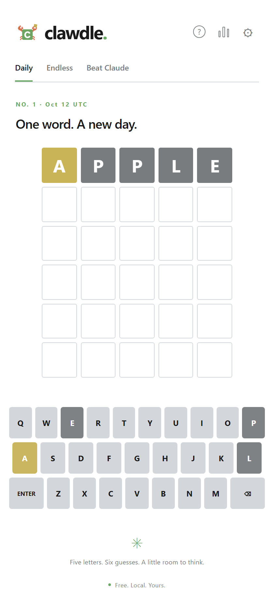

# clawdle.

A little word break while your coding agent works.



Clawdle is a free, local five-letter word game for Windows and the browser.
Solve a daily puzzle, play endless practice, or race a separate puzzle against
an observed local Claude Code turn. No account, API key, telemetry, hosted
database, or model call is required.

The [architecture](ARCHITECTURE.md) defines the product and its acceptance checks.
This repository is under active implementation; consult the
[verification ledger](docs/implementation.md) before relying on a capability.

## Play and develop

Use the Node version in `.node-version` and the pnpm version in `package.json`.

```sh
corepack enable
pnpm install --frozen-lockfile
pnpm dev:web
```

Open the local URL printed by Vite. Browser progress stays in IndexedDB on that
browser profile. Additional tabs observe the original tab; only one tab writes.
Export games from Settings before clearing browser storage.

```sh
pnpm typecheck
pnpm lint
pnpm test
pnpm exec playwright install chromium
pnpm test:e2e
pnpm build:web
```

The browser build is static output in `dist/web`. A first visit requires the
assets to be available; this release does not claim offline PWA installation.
The installed desktop application bundles the game and dictionary for offline use.

Desktop development also needs the pinned Rust toolchain and the
[Tauri Windows prerequisites](https://v2.tauri.app/start/prerequisites/).

```sh
pnpm test:rust
pnpm dev:desktop
pnpm build:desktop
```

## The games

- **Daily:** one official puzzle per UTC date. Six guesses; unfinished progress
  resumes. The schedule is frozen across installations.
- **Endless:** independent practice puzzles. Give up reveals the answer and
  records a practice loss. Closing the app preserves progress.
- **Beat Claude:** the desktop app observes local lifecycle hooks. The first
  applicable event in the durable native journal decides the race. A casual
  solve after Claude finishes cannot reverse its result or change a daily streak.
- **Speedrun:** enable it in Settings. Solve as many words as possible in sixty
  seconds. Exact deadline ties belong to the clock. Restart or interrupted timing
  makes a live run noncompetitive.

Green means the correct letter and position. Yellow means an unmatched copy
belongs elsewhere. Gray means no unmatched copy remains. Every accepted guess
is saved before its result is shown.

## Claude connection and privacy

Use the desktop connection dialog to choose global user settings or a selected
project. Setup preserves unrelated hooks and settings. Removal removes only
matching Clawdle-owned handlers. The application does not install hooks merely
because it has been installed.

Initial integration targets Windows-native Claude Code. WSL, SSH, remote agents,
and other providers are outside the verified connection path. Reliable turn
identity is required for ranked races; metadata without that identity can display
status only. A Stop event is an observed turn boundary, not proof a task passed
tests or finished successfully.

Clawdle discards prompt, response, transcript, tool argument, and code content.
It never approves agent permissions. It binds its receiver to authenticated
IPv4 loopback only; the browser game does not probe local agents.
See [privacy](docs/privacy.md), [installation](docs/installation.md), and
[troubleshooting](docs/troubleshooting.md).

## Licensing and contributions

Application code is [MIT licensed](LICENSE). Bundled dictionary data retains
the English Speller Database notice; see [third-party notices](THIRD_PARTY_NOTICES.md).
Dictionary generation uses a vendored pinned source and performs no downloads
during normal builds or gameplay. No Wordle answer schedule is used.

Read [contributing](docs/contributing.md) and the architecture before changing
race semantics, storage contracts, or the daily schedule. No paid service is
part of the required build or runtime.
